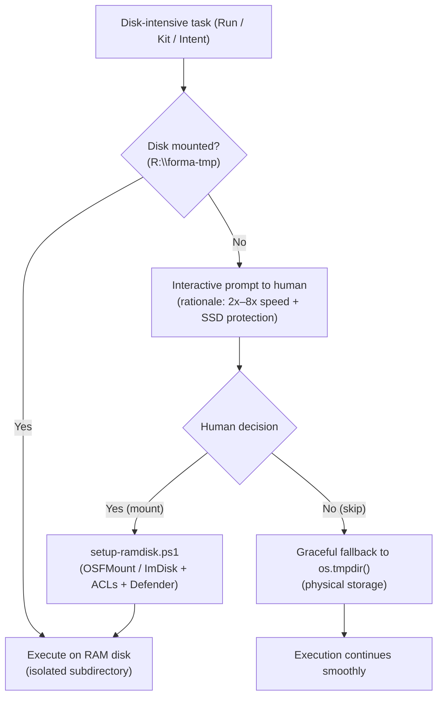
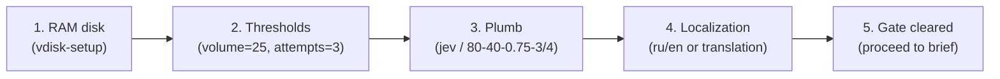

# Engine Functions and Architecture

Reference guide to key functional subsystems and hardware execution mechanisms of the Forma protocol. Describes internal architecture, machine resource physics, and rationale behind engineering decisions.

---

## 1. Virtual Disk Subsystem (RAM Disk)

For disk-intensive operations (test suite runs, artifact generation, isolated template initialization via `forma init`, script drafts), the protocol leverages an adaptive RAM disk in system memory.

### Purpose and Isolation

Test execution generates tens and hundreds of thousands of small temporary files. Moving the temporary base to RAM accomplishes three objectives:
1. **Execution speed:** eliminates physical storage controller latency and synchronous cache flushes.
2. **Zero storage wear (TBW):** physical SSD endurance is preserved, avoiding NAND Flash wear on transient data.
3. **Project isolation (`PROJECT_SLUG`):** each project receives its own dedicated subdirectory derived from the repository root name. Multiple simultaneously open projects never share a common temporary directory.

Temporary base resolution order:
`FORMA_TEST_TMP` → auto-detection (`R:\forma-tmp` on Windows, `/dev/shm/forma-tmp` on Linux) → graceful fallback (`os.tmpdir()`). Blind trust in paths is prohibited: even explicitly configured variables are verified for write access.

### Interaction with CPU

RAM disk operations actively and directly engage the central processing unit, substantially improving overall execution efficiency:

1. **Direct CPU kernel instruction execution:**
   A RAM disk has no dedicated hardware storage controller (unlike SSD controller ASICs). Storage I/O requests are intercepted by the kernel driver (`OSFDisk.sys` / `imdisk.sys`) and translated into direct memory copy calls (`RtlCopyMemory`, assembly instructions `rep movsb`, AVX vector registers). The CPU itself transfers the data via the integrated memory controller (IMC).
2. **Elimination of CPU I/O Wait:**
   With standard storage, the CPU issues an I/O command to the SSD controller and enters an idle wait state (*I/O wait*) pending PCIe bus interrupts. Across thousands of small files, significant CPU cycles are lost to context switching. On a RAM disk, access latency is measured in nanoseconds — threads never block on I/O, allowing CPU cores to operate at 100% useful computational throughput.
3. **Contention-free parallelism:**
   The protocol test runner dispatches workloads across 16 parallel worker threads (`test-concurrency`). On physical drives, threads contend for storage controller queue depth. In a RAM disk, all CPU cores operate concurrently against DDR memory pages without disk-level lock contention.

### Comparative Performance Analysis

Hardware benchmark results on production hardware (RAM disk `R:` vs system NVMe SSD `C:` WD PC SN540 and workspace NVMe SSD `D:` ADATA LEGEND):

| Operation | RAM Disk (`R:`) | System SSD (`C:`) | Project SSD (`D:`) | RAM Disk Advantage |
| :--- | :--- | :--- | :--- | :--- |
| **Create 2,000 small files** | **0.199 s** (10,061 ops/s) | 1.493 s (1,339 ops/s) | 0.831 s (2,406 ops/s) | **4.2x – 7.5x faster** |
| **Random read 2,000 files** | **0.072 s** (27,766 ops/s) | 0.126 s (15,816 ops/s) | 0.107 s (18,777 ops/s) | **1.5x – 1.75x faster** |
| **Delete directory (2,000 files)** | **0.083 s** | 0.213 s | 0.171 s | **2.1x – 2.6x faster** |
| **Sequential write (100 MB)** | **1,568.8 MB/s** | 810.6 MB/s | 903.2 MB/s | **1.7x – 1.9x faster** |
| **Sequential read (100 MB)** | **1,743.7 MB/s** | 1,342.7 MB/s | 1,446.6 MB/s | **1.2x – 1.3x faster** |

The primary performance gain stems not from sequential megabyte streaming, but from filesystem metadata latency (MFT/inodes) and bulk small file generation, where the RAM disk outperforms high-speed NVMe SSDs by up to 7.5x.

### Fault Tolerance and Safety

1. **Graceful degradation:** if the virtual disk is unmounted or unreachable, the process does not terminate, falling back automatically to `os.tmpdir()` with a user notification.
2. **Clean boundary:** volatile memory hosts only ephemeral, regenerable data — repository trees, git history, and secrets are strictly excluded.
3. **Antivirus hygiene:** the RAM disk path should be placed in realtime scanning exclusion lists with periodic scheduled background scans.

### Interactive On-Demand Provisioning (vdisk-setup)

The `vdisk-setup` core skill activates on a Just-In-Time (JIT) basis whenever a node (`Run`, `Kit`, or `Intent` itself) faces disk-intensive operations:
- Test suite execution (`npm test`, `test-runner.cjs`).
- Assembly and refinement of web page mockups, HTML/CSS/JS generation, and build bundles.
- Batch script drafts and operations handling thousands of small files.

If the disk is unmounted, the agent neither fails nor degrades silently; instead, it presents an interactive decision request with clear benefit rationale:

## 2. Initial Project Onboarding Wizard (project-setup)

Initial setup of a fresh project in the Forma protocol is automated via the `project-setup` conversational core skill. It resolves the startup blocking gate (`AGENTS.md` §3 "STOP START"), populating required configuration in `project/config/PROJECT.md` without requiring manual file edits.

### Five Steps of Initial Setup

1. **Virtual RAM Disk (`vdisk-setup`):** Checks `R:\forma-tmp` availability and offers to provision the disk, ensuring all subsequent tests and builds run in high-speed RAM from day one.
2. **Protocol Thresholds:** Sets canonical baseline values — 25 cards per cycle (`volume`) and at most 3 attempts per task (`attempts`). Token spend and elapsed time remain metrics and are never capped in advance.
3. **Plumb Decision Model:** Configures the decision model (recommended external `typesafe/jev-1.14` via OpenRouter Decisions API or the in-family fallback of the engine: `haiku` / `gemini-3.8-flash` / `gpt-5.6-luna` / `minimax-flash` / `glm-flash`), calibrates thresholds (leader ≥ 80%, margin ≥ 40%, noul ≥ 0.75, clarity ≥ 3/4, 100 calls per cycle), and verifies `.env` secret availability safely (prohibition 15).
4. **Localization (i18n):** Checks the project document language. If a non-bundled language is chosen (beyond built-in `ru` and `en`), creates `.forma/translation-pending.json` and launches scaffold translation.
5. **Start Gate Clearance:** Runs `check-ready.cjs`, confirms the removal of "STOP START", and hands off cleanly to the goal briefing interview (`grilling` / `forma-grill-with-ui`).
