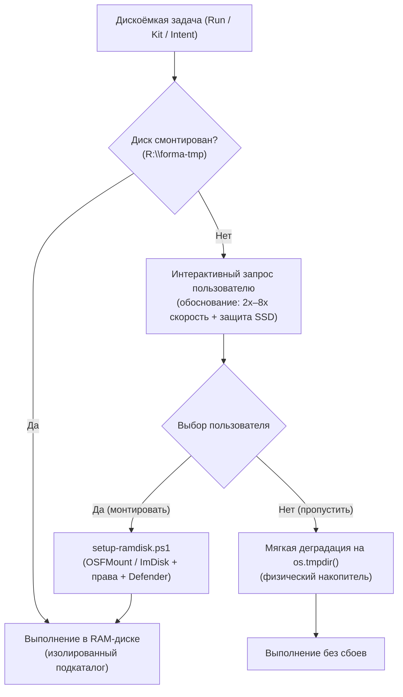
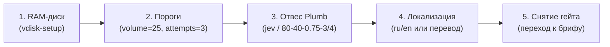

# Функции и архитектура движка

Справочник ключевых функциональных подсистем и аппаратных механизмов исполнения протокола Forma. Описывает внутреннее устройство, физику работы с ресурсами машины и обоснование выбранных инженерных решений.

---

## 1. Подсистема виртуального диска (RAM-диск)

Для интенсивных дисковых операций (прогоны тестов, генерация артефактов, изолированная инициализация шаблонов `forma init`, черновики скриптов) протокол задействует адаптивный RAM-диск в оперативной памяти.

### Назначение и изоляция

При запуске тестов создаются десятки и сотни тысяч временных файлов. Вынос временной базы в оперативную память решает три задачи:
1. **Скорость прогона:** устраняются микрозадержки физического контроллера накопителя и транзакционный сброс кэша.
2. **Нулевой износ накопителя (TBW):** физический SSD не расходует ресурс ячеек NAND Flash на короткоживущие файлы.
3. **Изоляция проектов (`PROJECT_SLUG`):** каждый проект получает собственный изолированный подкаталог, выводимый из имени корня репозитория. Несколько одновременно открытых проектов никогда не делят общую папку временных данных.

Порядок разрешения временной базы:
`FORMA_TEST_TMP` → автоопределение (`R:\forma-tmp` на Windows, `/dev/shm/forma-tmp` на Linux) → системный откат (`os.tmpdir()`). Слепая вера в путь запрещена: даже заданная переменная проверяется на доступность на запись.

### Взаимодействие с процессором (CPU)

Работа с RAM-диском активно и прямо задействует центральный процессор, кардинально повышая общую эффективность исполнения:

1. **Прямое выполнение инструкций ядра CPU:**
   У RAM-диска отсутствует собственный контроллер (в отличие от аппаратных чипов SSD). Обращения к диску перехватываются драйвером ядра (`OSFDisk.sys` / `imdisk.sys`) и транслируются в прямые вызовы копирования памяти (`RtlCopyMemory`, ассемблерные инструкции `rep movsb`, векторные регистры AVX). Данные переносит сам процессор через интегрированный контроллер памяти (IMC).
2. **Устранение процессорного простоя (CPU I/O Wait):**
   При работе с обычным накопителем процессор отправляет команду I/O контроллеру SSD и переводит поток в ожидание прерывания по шине PCIe (*I/O wait*). При тысячах мелких файлов процессор теряет такты на переключения контекста. На RAM-диске латентность доступа составляет единицы наносекунд — поток не блокируется, ядра процессора загружаются на 100% полезной вычислительной работой.
3. **Параллелизм без очередей:**
   Раннер тестов протокола распределяет нагрузку на 16 параллельных потоков (`test-concurrency`). На физическом накопителе потоки конкурируют за очередь к контроллеру диска. В RAM-диске все ядра процессора параллельно оперируют своими страницами памяти в DDR без взаимных дисковых блокировок.

### Сравнительный анализ производительности

Замеры на реальном оборудовании (RAM-диск `R:` против системного NVMe SSD `C:` WD PC SN540 и проектного NVMe SSD `D:` ADATA LEGEND):

| Операция | RAM-диск (`R:`) | Системный SSD (`C:`) | Проектный SSD (`D:`) | Выигрыш RAM-диска |
| :--- | :--- | :--- | :--- | :--- |
| **Создание 2 000 мелких файлов** | **0.199 с** (10 061 оп/с) | 1.493 с (1 339 оп/с) | 0.831 с (2 406 оп/с) | **в 4.2 – 7.5 раз быстрее** |
| **Случайное чтение 2 000 файлов** | **0.072 с** (27 766 оп/с) | 0.126 с (15 816 оп/с) | 0.107 с (18 777 оп/с) | **в 1.5 – 1.75 раза быстрее** |
| **Удаление каталога (2 000 файлов)** | **0.083 с** | 0.213 с | 0.171 с | **в 2.1 – 2.6 раза быстрее** |
| **Линейная запись (100 МБ)** | **1 568.8 МБ/с** | 810.6 МБ/с | 903.2 МБ/с | **в 1.7 – 1.9 раза быстрее** |
| **Линейное чтение (100 МБ)** | **1 743.7 МБ/с** | 1 342.7 МБ/с | 1 446.6 МБ/с | **в 1.2 – 1.3 раза быстрее** |

Главный выигрыш достигается не на потоковой передаче мегабайтов, а на латентности метаданных файловой системы (MFT/inodes) и массовом создании мелких файлов, где RAM-диск опережает быстрые NVMe SSD до 7.5 раз.

### Отказоустойчивость и безопасность

1. **Безусловная деградация:** если виртуальный диск не смонтирован или недоступен, процесс не падает, а автоматически переключается на `os.tmpdir()` с предупреждением человеку.
2. **Чистая зона:** в оперативной памяти живут только регенерируемые данные — дерево репозитория, история git и учётные данные туда никогда не переносятся.
3. **Антивирусная защита:** путь RAM-диска рекомендуется вносить в исключения сканирования реального времени с регулярной фоновой проверкой по расписанию.

### Интерактивное подключение по требованию (vdisk-setup)

Скилл ядра `vdisk-setup` активируется по принципу Just-In-Time (JIT) в любой момент, когда узел (`Run`, `Kit` или сам `Intent`) сталкивается с необходимостью выполнения файлоёмких операций:
- Прогоны тестовых наборов (`npm test`, `test-runner.cjs`).
- Сборка и доводка макетов веб-страниц, генерация HTML/CSS/JS и бандлов.
- Пакетные черновики скриптов и манипуляции с тысячами файлов.

Если диск не смонтирован, агент не падает и не деградирует молча, а запрашивает выбор у пользователя с ясным обоснованием преимуществ:

## 2. Мастер первого запуска проекта (project-setup)

Первичная настройка нового проекта в протоколе Forma автоматизирована в виде диалогового скилла ядра `project-setup`. Он решает проблему стартового блокирующего гейта (`AGENTS.md` §3 «СТОП СТАРТА»), заполняя обязательную конфигурацию в `project/config/PROJECT.md` без необходимости ручного редактирования файлов.

### Пять шагов первичной настройки

1. **Виртуальный RAM-диск (`vdisk-setup`):** Проверка готовности `R:\forma-tmp` и предложение смонтировать диск для ускорения всех последующих тестов и сборок с первой минуты жизни проекта.
2. **Пороги протокола (Thresholds):** Установка эталонных значений — 25 карточек на круг (`volume`) и не более 3 заходов на задачу (`attempts`). Расход токенов и время остаются статистикой и не лимитируются.
3. **Отвес (Plumb):** Подключение модели решений (рекомендованный внешний исполнитель `typesafe/jev-1.14` через OpenRouter Decisions API либо встроенный `haiku`/`gemini-flash`), калибровка порогов (лидер ≥ 80%, зазор ≥ 40%, noul ≥ 0.75, ясность ≥ 3/4, 100 вызовов на круг) и безопасная проверка ключа в `.env` (запрет 15).
4. **Локализация (i18n):** Проверка языка проекта. Если выбран язык, отличный от встроенных `ru` и `en`, формируется маркер `.forma/translation-pending.json` и запускается процедура перевода каркаса документации.
5. **Снятие стартового гейта:** Запуск `check-ready.cjs`, подтверждение отсутствия «СТОП СТАРТА» и плавный переход к интервью целей (`grilling` / `forma-grill-with-ui`).
